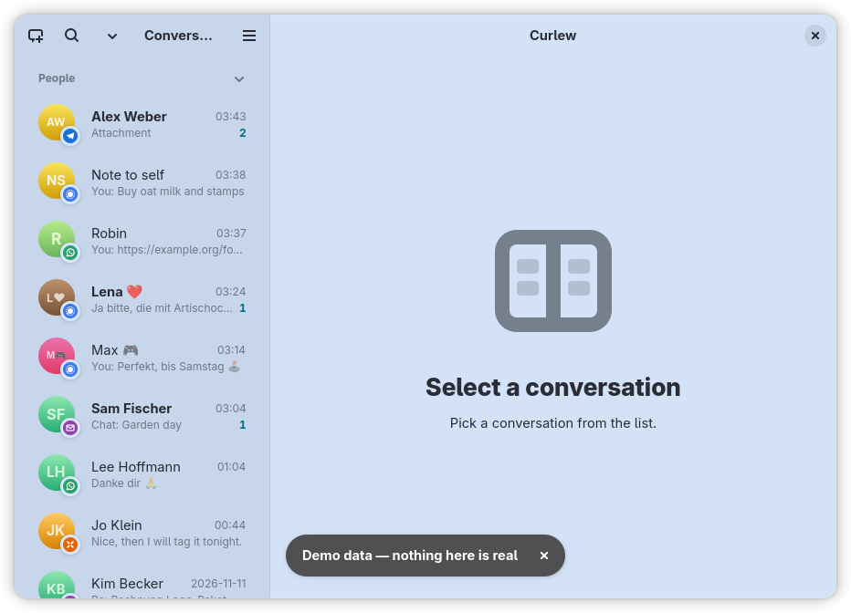
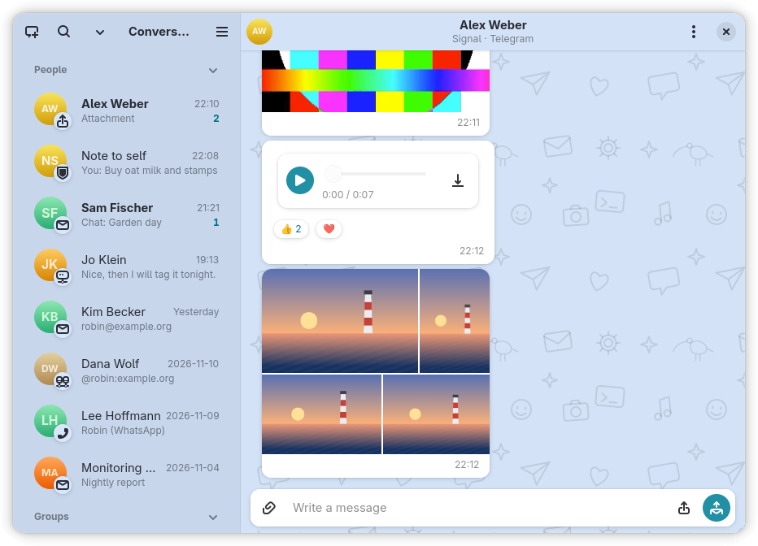
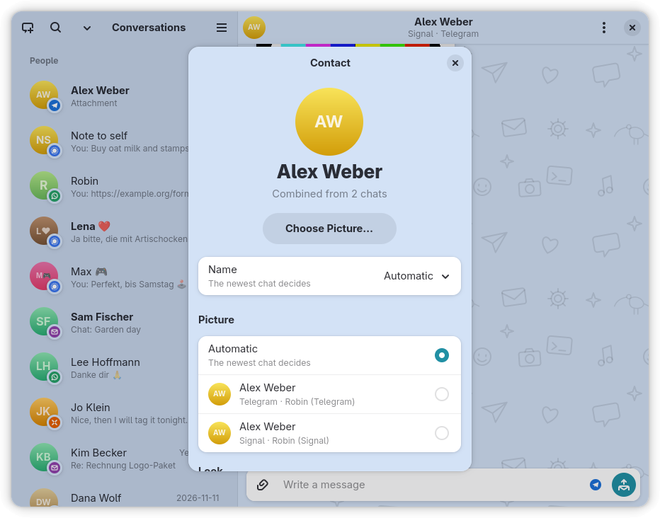
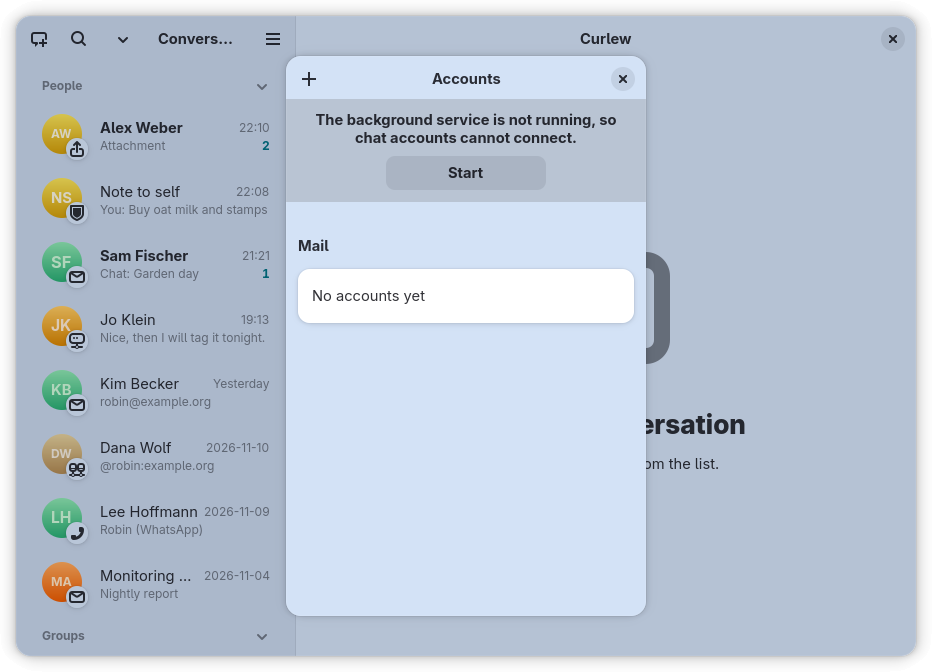

<p align="center">
  
</p>

# Curlew

One chat per person, across every messenger. Curlew is a GNOME app that brings your mail and your
chats from Telegram, Signal, WhatsApp, Matrix and XMPP into a single list, so a person is one
conversation however they reach you. Reply from the same window, send and open pictures, voice
messages and files, and choose which messenger a person is reached through.

Mail is one protocol among the others, and it can show mail threads as email chats in the Delta
Chat style. AI assistants can work with your messages through an [MCP](https://modelcontextprotocol.io)
server, but that is an option, and it is off until you turn it on.

## Screenshots

<!-- Produced by dev/screenshots.sh into docs/screenshots/ (see docs/screenshots/README.md). -->

| | |
|---|---|
|  |  |
|  |  |

The narrow layout for phones and small windows: `docs/screenshots/conversation-narrow.en.light.png`.
Dark mode and German variants sit next to these files.

## Protocols

What each protocol can do, as its backend manifest declares it (`packages/*/src/manifest.ts`).
The columns describe what the network allows; the window offers an action only where the chat in
front of you can do it ([ADR 0015](docs/adr/0015-capabilities-per-thread.md)).

| Protocol | History | Groups | Reactions | Edit / delete own | Threads | Read receipts | End-to-end encrypted | Send files | Open received files |
|---|---|---|---|---|---|---|---|---|---|
| Mail (IMAP/SMTP) | server archive | yes | yes | yes | yes | no | no | yes | yes |
| Telegram | server archive | yes | yes | yes | forum topics | yes | no (cloud chats) | yes | yes |
| Signal (linked device) | only on this computer | yes | yes | yes | no | yes | yes | no | yes |
| WhatsApp (linked device, **unofficial**) | only on this computer | yes | yes | yes | no | yes | yes | yes | yes |
| Matrix | server archive | yes | yes | yes | yes | yes | decrypts; sends to unencrypted rooms only | yes | yes |
| XMPP | server archive (MAM) | yes | yes, where the peer supports it | yes, where the peer supports it | no | no | OMEMO ([ADR 0006](docs/adr/0006-omemo-end-to-end-encryption.md)) | yes | yes |

- Every protocol except mail is **off until you enable it**, and Telegram, Signal and WhatsApp show
  their terms first. WhatsApp is an unofficial client and can get the account banned; Signal does
  not license third-party clients.
- Signal and WhatsApp keep no server archive: what Curlew receives is the only copy, so the
  [receiving daemon](docs/guide/daemon.md) matters there.
- Setup, terms and behaviour per protocol: [docs/guide/protocols.md](docs/guide/protocols.md).

### Mail and email chats

Mail accounts are added in Curlew (*Add Account → Mail*: an address and a password), or, on a
GNOME desktop, taken from GNOME Settings → Online Accounts. Mail threads that carry the open
`Chat-Version` marker are shown as email chats in the Delta Chat style: bubbles instead of a
mailbox. Sending the marker is a setting of each mail account and **off by default**
([ADR 0014](docs/adr/0014-delta-chat-is-a-protocol.md)). People without such a client simply get
normal mail. Compatibility with Delta Chat itself has not been confirmed against a live peer yet,
so Curlew does not claim it.

## AI assistants and MCP (optional, off by default)

`curlew mcp` serves your messages to an AI assistant over MCP, but only if you switch AI on
(*Preferences → AI*). Off, every agent request is denied and the server offers nothing. On, you
decide per account and contact whether an agent may read, send, or must ask you first
([ADR 0009](docs/adr/0009-agent-access-per-account-and-contact.md)). Your own actions in the window
are never restricted ([ADR 0008](docs/adr/0008-grants-restrict-agents-not-the-person.md)).
Details: [docs/guide/mcp-and-data.md](docs/guide/mcp-and-data.md).

## Privacy

- Your messages are indexed in a local SQLite database (`$XDG_DATA_HOME/curlew/index.db`, mode
  `0600`) and nowhere else. Curlew talks to your mail server and to the messengers you enabled,
  and to nothing else. There is no Curlew server, no telemetry.
- Passwords and session keys are kept in files readable only by you, or come from GNOME Online
  Accounts at runtime; they are never logged.
- Opening a mail never marks it as read, and no messenger gets read receipts or presence from an
  agent.
- What lives where, and what you can rebuild: [docs/privacy/data-tiers.md](docs/privacy/data-tiers.md).

## Install

Chat is what the packaged builds below offer. Contacts and calendar through GNOME Online Accounts
and Evolution Data Server are a feature of the Linux host build only.

- **Flatpak** (Linux): CI builds one on every release, with network and display access and nothing
  else. Flathub is not published yet ([ADR 0011](docs/adr/0011-same-app-inside-and-outside-a-sandbox.md)).
- **Windows** and **macOS**: unsigned packages are attached to each
  [GitHub release](https://github.com/JumpLink/curlew/releases). Chat only: GNOME accounts do not
  exist there.
- **`.deb` / `.rpm`** (x86_64): attached to each release as well.

How the artifacts are built: [docs/guide/releasing.md](docs/guide/releasing.md).

## Build from source

```bash
gjsify install
gjsify workspace curlew-cli build
CURLEW_DEMO=1 gjsify run app/dist/curlew.gjs.mjs window    # the window, on made-up data
```

Curlew runs on GJS through [gjsify](https://github.com/gjsify/gjsify). Needs GTK 4, libadwaita and
`libgda-sqlite`; the GNOME features also need GNOME Online Accounts and Evolution Data Server.
The command line, `curlew setup` and the systemd unit for the daemon are covered in
[docs/guide/cli.md](docs/guide/cli.md).

## Documentation

- [docs/README.md](docs/README.md): the index
- Decisions: [docs/adr/](docs/adr/), starting with [ADR 0001](docs/adr/0001-multi-protocol-messenger.md)
- Design: [docs/design/ui.md](docs/design/ui.md)
- Contributing and agent rules: [AGENTS.md](AGENTS.md)
- Translations: English sources, German in [`po/de.po`](po/de.po); see [docs/i18n-status.md](docs/i18n-status.md)
- [CHANGELOG.md](CHANGELOG.md)

## License

[AGPL-3.0-or-later](LICENSE) © Pascal Garber.

The apps (`app/`) are AGPL-3.0-or-later. The reusable packages under `packages/` are
[LGPL-3.0-or-later](packages/protocol/LICENSE), each with its own `LICENSE` and `COPYING`, so
other programs can link them. The exception is `@curlew/signal`, which stays AGPL-3.0-or-later:
it builds on libsignal-client (AGPL-3.0-only) and contains code ported from Signal Desktop.

The AGPL adds one condition to the GPL: anyone who runs this program **as a network service** must
offer that service's users the source of their version. Running it locally for yourself adds no
obligation.
