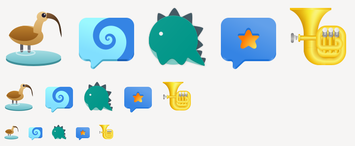
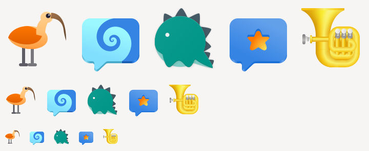
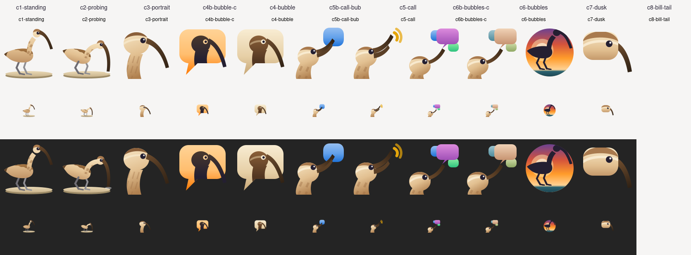
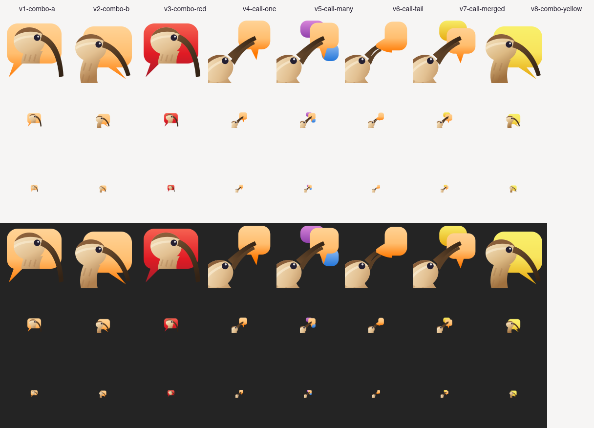
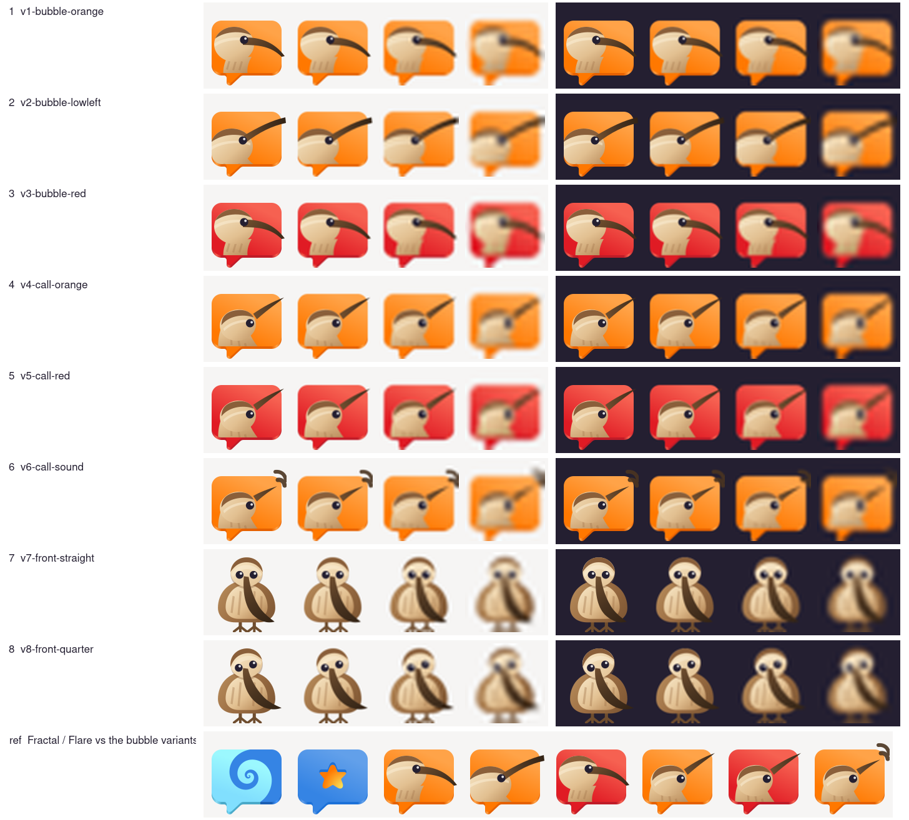
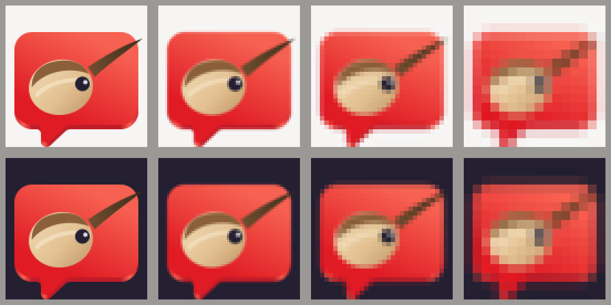
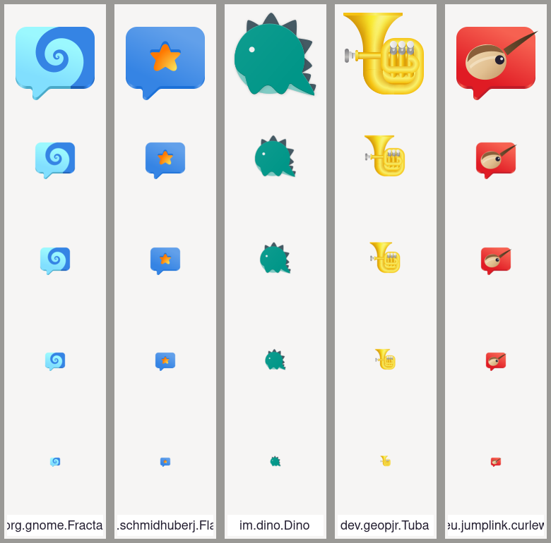
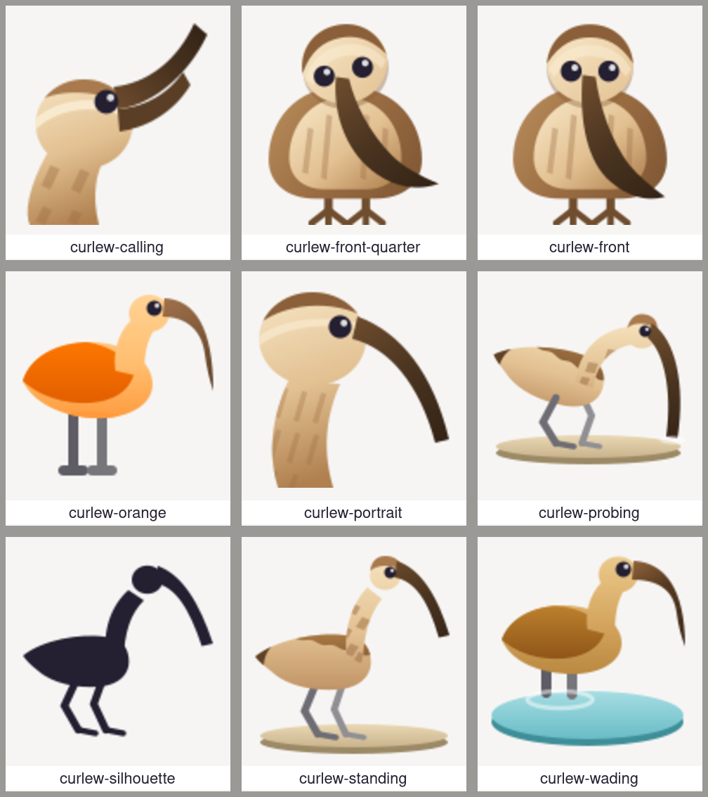

# App icon — how it came about

The icon follows the [GNOME HIG for app icons](https://developer.gnome.org/hig/guidelines/app-icons.html):
GNOME palette, 128 px canvas, recognisable at 32 and 16 px, a matching symbolic icon. Every round
is hand-written SVG, rendered with `rsvg-convert` and compared beside Fractal, Flare, Dino and
Tuba. This folder keeps each round's overview, the contact sheets and the source SVGs, so the
decisions can be followed later.

The name: the curlew (*Numenius arquata*) follows the bird-named multi-messengers Pidgin and
Adium. Its one feature everybody recognises is the long, downcurved bill.

## Round 1 — two colour variants

- **A, natural** (`round1/eu.jumplink.curlew-variant-a.svg`): a curlew wading in a tide pool, real
  plumage colours.
- **B, colourful** (`round1/eu.jumplink.curlew-variant-b.svg`): the same bird as a flat orange
  graphic.
- Symbolic: `round1/symbolic-strip.png`.

Feedback: the bird was too small next to icons that fill the canvas; the posture was hunched with
short legs, where a real curlew stands upright on long legs; the plumage was flat; the symbolic
read as a hook, not a bird. Asked for: new concepts that differ in composition and view, not only
in colour — including ones that carry the messenger idea (the call, speech bubbles).

## Round 2 — eight concepts

| # | File | Idea |
|---|---|---|
| 1 | `c1-standing.svg` | whole bird standing on a mudflat, side view |
| 2 | `c2-probing.svg` | the bird probing the sand with its bill |
| 3 | `c3-portrait.svg` | head and neck, the bill as the dominant diagonal |
| 4 | `c4-bubble.svg`, `c4b-bubble-c.svg` | the head on a speech bubble, sand / orange |
| 5 | `c5-call.svg`, `c5b-call-bub.svg` | the call: sound arcs / a bubble from the bill |
| 6 | `c6-bubbles.svg`, `c6b-bubbles-c.svg` | three bubbles for the combined networks |
| 7 | `c7-dusk.svg` | silhouette against a dusk disc |
| 8 | `c8-bill-tail.svg` | bubble and bird in one shape |

Strongest: 3 as the bird, 4b as the messenger icon (contact sheets in `round2/`). Symbolic:
`sym-head.svg` (head with eye) clearly beat `sym-bubble.svg` (`round2/symbolic-strip.png`).

Feedback: combine them — the light, streaked head of 3 on the orange bubble of 4b, since 4b's
dark silhouette read as a penguin or an ibis. Also keep the calling idea of 5 and 6 with the bill
held up, but with a larger head and one natural curve of neck and bill instead of a kink, and
fewer, larger bubbles so it stays calm at 32 px.

## Round 3 — combinations and the call

| # | File | Idea |
|---|---|---|
| 1 | `v1-combo-a.svg` | orange bubble, the head of 3 painted on it, the bill breaking out at the lower right |
| 2 | `v2-combo-b.svg` | the bubble as backdrop, the bird in front of it from the lower left |
| 3 | `v3-combo-red.svg` | 1 in GNOME red |
| 4 | `v4-call-one.svg` | calling, bill raised, one orange bubble |
| 5 | `v5-call-many.svg` | calling, three bubbles for the several networks |
| 6 | `v6-call-tail.svg` | calling, the bill's curve runs on into the bubble |
| 7 | `v7-call-merged.svg` | calling, two warm bubbles merged into one outline |
| 8 | `v8-combo-yellow.svg` | 2 in GNOME yellow |

Strongest: 3 (red) and 1 (orange) — the only ones that stay both a bird and a message at 16 px
(contact sheets in `round3/`). The calling variants have the right posture now, but leave two
corners empty and read as a tool rather than a bird at 16 px. Symbolic: `sym-head.svg` again;
`sym-call.svg` failed at 16 px (`round3/symbolic-strip.png`).

Feedback: the bubble must have exactly the shape of Fractal's and Flare's, so the icons line up
side by side in GNOME; only the painting differs. Put the calling pose of 4–7 inside that bubble
the way 1–3 sit in it. Add a bird-only variant seen from the front, looking at the viewer, like
Pidgin.

## Round 4 — the shared bubble, the call inside it, the frontal bird

The bubble outline, radius, tail and base are traced from Fractal and Flare once and emitted from
one block in `round4/build.py`; the `ref` row of the overview sets them side by side.

| # | File | Idea |
|---|---|---|
| 1 | `v1-bubble-orange.svg` | the shared bubble in orange, the head low left, the bill breaking out right |
| 2 | `v2-bubble-lowleft.svg` | the head entering from the lower left, the bill sweeping up across |
| 3 | `v3-bubble-red.svg` | 1 in GNOME red |
| 4 | `v4-call-orange.svg` | the calling pose inside the bubble, the bill rising out at the top right |
| 5 | `v5-call-red.svg` | 4 in red |
| 6 | `v6-call-sound.svg` | 4 with two sound arcs at the bill tip |
| 7 | `v7-front-straight.svg` | the whole bird from the front, Pidgin style |
| 8 | `v8-front-quarter.svg` | 7 turned slightly, so the bill's curve shows |

Strongest: 3 (still legible at 16 px on both themes) and 8 (the strongest new idea: the only bird
in a messenger tray; reads down to 32 px). 4 and 5 are handsome at 128 px, but at 32 px only the
bill stroke survives; the arcs of 6 read as a detached hook. Symbolic: `sym-head.svg` and
`sym-bubble.svg` hold at 16 px; `sym-front.svg` failed — head-on, the bill points at the viewer
and one colour cannot draw it.

## Final — Pascal's variant

Pascal took round-4 variant 5 (calling, red bubble) and removed the neck in Inkscape
(`final/pascal-v5b-call-red.svg`): a round head with the cap and the eye in the middle of the
shared bubble, the bill rising out at the top right. The shipped
`app/data/icons/hicolor/scalable/apps/eu.jumplink.curlew.svg` is that file with only the editor
metadata removed; it renders pixel-identical (`magick compare -metric AE` = 0 at 16–1024 px).

Symbolic: the head alone, eye punched out, bill rising to the top right
(`final/symbolic-strip.png`); a version inside a bubble outline closed up the eye at 16 px.

The bird views without a bubble are kept as illustrations for the README and the app, in
[`app/data/illustrations/`](../../../app/data/illustrations/README.md):

