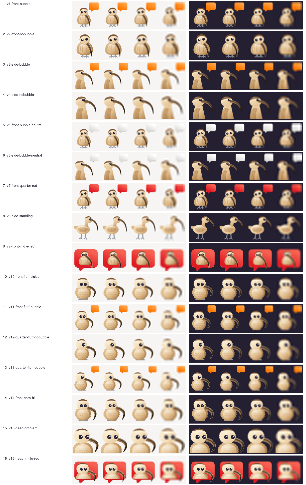
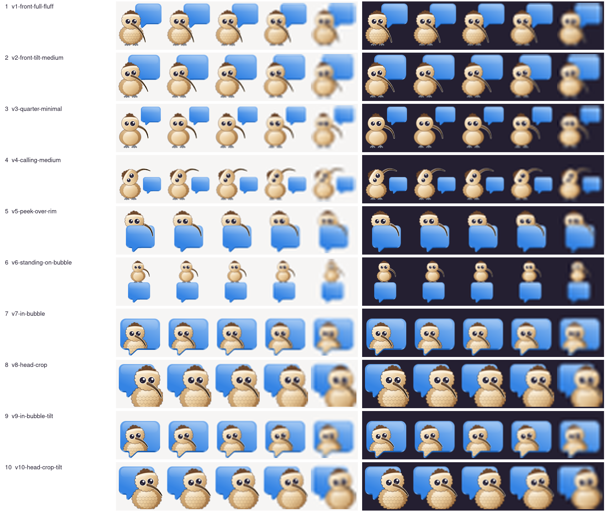

# App icon — how it came about

The icon follows the [GNOME HIG for app icons](https://developer.gnome.org/hig/guidelines/app-icons.html):
GNOME palette, 128 px canvas, recognisable at 32 and 16 px, a matching symbolic icon. Every round
is hand-written SVG, rendered with `rsvg-convert` and compared beside Fractal, Flare, Dino and
Tuba. This folder keeps each round's overview, the contact sheets and the source SVGs, so the
decisions can be followed later.

The name: the curlew (*Numenius arquata*) follows the bird-named multi-messengers Pidgin and
Adium. Its one feature everybody recognises is the long, downcurved bill.

## Round 1 — two colour variants

- **A, natural** (`round1/eu.jumplink.curlew-variant-a.svg`): a curlew wading in a tide pool, real
  plumage colours.
- **B, colourful** (`round1/eu.jumplink.curlew-variant-b.svg`): the same bird as a flat orange
  graphic.
- Symbolic: `round1/symbolic-strip.png`.

Feedback: the bird was too small next to icons that fill the canvas; the posture was hunched with
short legs, where a real curlew stands upright on long legs; the plumage was flat; the symbolic
read as a hook, not a bird. Asked for: new concepts that differ in composition and view, not only
in colour — including ones that carry the messenger idea (the call, speech bubbles).

## Round 2 — eight concepts

| # | File | Idea |
|---|---|---|
| 1 | `c1-standing.svg` | whole bird standing on a mudflat, side view |
| 2 | `c2-probing.svg` | the bird probing the sand with its bill |
| 3 | `c3-portrait.svg` | head and neck, the bill as the dominant diagonal |
| 4 | `c4-bubble.svg`, `c4b-bubble-c.svg` | the head on a speech bubble, sand / orange |
| 5 | `c5-call.svg`, `c5b-call-bub.svg` | the call: sound arcs / a bubble from the bill |
| 6 | `c6-bubbles.svg`, `c6b-bubbles-c.svg` | three bubbles for the combined networks |
| 7 | `c7-dusk.svg` | silhouette against a dusk disc |
| 8 | `c8-bill-tail.svg` | bubble and bird in one shape |

Strongest: 3 as the bird, 4b as the messenger icon (contact sheets in `round2/`). Symbolic:
`sym-head.svg` (head with eye) clearly beat `sym-bubble.svg` (`round2/symbolic-strip.png`).

Feedback: combine them — the light, streaked head of 3 on the orange bubble of 4b, since 4b's
dark silhouette read as a penguin or an ibis. Also keep the calling idea of 5 and 6 with the bill
held up, but with a larger head and one natural curve of neck and bill instead of a kink, and
fewer, larger bubbles so it stays calm at 32 px.

## Round 3 — combinations and the call

| # | File | Idea |
|---|---|---|
| 1 | `v1-combo-a.svg` | orange bubble, the head of 3 painted on it, the bill breaking out at the lower right |
| 2 | `v2-combo-b.svg` | the bubble as backdrop, the bird in front of it from the lower left |
| 3 | `v3-combo-red.svg` | 1 in GNOME red |
| 4 | `v4-call-one.svg` | calling, bill raised, one orange bubble |
| 5 | `v5-call-many.svg` | calling, three bubbles for the several networks |
| 6 | `v6-call-tail.svg` | calling, the bill's curve runs on into the bubble |
| 7 | `v7-call-merged.svg` | calling, two warm bubbles merged into one outline |
| 8 | `v8-combo-yellow.svg` | 2 in GNOME yellow |

Strongest: 3 (red) and 1 (orange) — the only ones that stay both a bird and a message at 16 px
(contact sheets in `round3/`). The calling variants have the right posture now, but leave two
corners empty and read as a tool rather than a bird at 16 px. Symbolic: `sym-head.svg` again;
`sym-call.svg` failed at 16 px (`round3/symbolic-strip.png`).

Feedback: the bubble must have exactly the shape of Fractal's and Flare's, so the icons line up
side by side in GNOME; only the painting differs. Put the calling pose of 4–7 inside that bubble
the way 1–3 sit in it. Add a bird-only variant seen from the front, looking at the viewer, like
Pidgin.

## Round 4 — the shared bubble, the call inside it, the frontal bird

The bubble outline, radius, tail and base are traced from Fractal and Flare once and emitted from
one block in `round4/build.py`; the `ref` row of the overview sets them side by side.

| # | File | Idea |
|---|---|---|
| 1 | `v1-bubble-orange.svg` | the shared bubble in orange, the head low left, the bill breaking out right |
| 2 | `v2-bubble-lowleft.svg` | the head entering from the lower left, the bill sweeping up across |
| 3 | `v3-bubble-red.svg` | 1 in GNOME red |
| 4 | `v4-call-orange.svg` | the calling pose inside the bubble, the bill rising out at the top right |
| 5 | `v5-call-red.svg` | 4 in red |
| 6 | `v6-call-sound.svg` | 4 with two sound arcs at the bill tip |
| 7 | `v7-front-straight.svg` | the whole bird from the front, Pidgin style |
| 8 | `v8-front-quarter.svg` | 7 turned slightly, so the bill's curve shows |

Strongest: 3 (still legible at 16 px on both themes) and 8 (the strongest new idea: the only bird
in a messenger tray; reads down to 32 px). 4 and 5 are handsome at 128 px, but at 32 px only the
bill stroke survives; the arcs of 6 read as a detached hook. Symbolic: `sym-head.svg` and
`sym-bubble.svg` hold at 16 px; `sym-front.svg` failed — head-on, the bill points at the viewer
and one colour cannot draw it.

## Final — Pascal's variant

Pascal took round-4 variant 5 (calling, red bubble) and removed the neck in Inkscape
(`final/pascal-v5b-call-red.svg`): a round head with the cap and the eye in the middle of the
shared bubble, the bill rising out at the top right. The shipped
`app/data/icons/hicolor/scalable/apps/eu.jumplink.curlew.svg` is that file with only the editor
metadata removed; it renders pixel-identical (`magick compare -metric AE` = 0 at 16–1024 px).

Symbolic: the head alone, eye punched out, bill rising to the top right
(`final/symbolic-strip.png`); a version inside a bubble outline closed up the eye at 16 px.

The bird views without a bubble are kept as illustrations for the README and the app, in
[`app/data/illustrations/`](../../../app/data/illustrations/README.md):

## Round 5 — the Pidgin idea in curlew: the bird itself, with the bubble as a badge

Pidgin's layout rather than Pidgin's art: the animal carries the icon and the message bubble is
shrunk to a badge at the upper right, where its tail — the shared Fractal/Flare outline, copied
from `round4/build.py` — points back at the bird. Both views are drawn from the same generator,
`round5/build5.py`: the bill is a sampled cubic centreline with a tapering width profile, so the
outline, the paler lower mandible, the dark tip and the gloss are all offsets of one curve and
cannot drift apart. `round5/render5.sh` writes the overview at 128/64/32/16 px and
`round5/details.png` at 256 px.

| # | File | Idea |
|---|---|---|
| 1 | `v1-front-bubble.svg` | frontal bird, orange badge bubble, the bill crossing the breast and hanging free below |
| 2 | `v2-front-nobubble.svg` | 1 alone, filling the canvas, so the bill gets the whole width |
| 3 | `v3-side-bubble.svg` | profile, the sickle on the full diagonal, orange badge bubble |
| 4 | `v4-side-nobubble.svg` | 3 alone: the longest and most legible bill in the set |
| 5 | `v5-front-bubble-neutral.svg` | 1 with the bubble in light neutral, so the bird's buff carries the icon |
| 6 | `v6-side-bubble-neutral.svg` | 3 with the neutral bubble |
| 7 | `v7-front-quarter-red.svg` | the frontal bird turned further, bubble in the red of the shipped icon |
| 8 | `v8-side-standing.svg` | the whole bird on its legs, the way a curlew is seen on a mudflat |
| 9 | `v9-front-in-tile-red.svg` | the frontal bird inside the full-size bubble, continuity with the shipped icon |

### Round 5b — the Adium idea: a chunky fluffy mascot with the bill as the hero shape

Adium answers the same problem differently: the body is a soft chunky blob with a feathered
fringe, and the beak is the one big saturated shape on it. Only the idea is taken — fringe,
chunk, big eyes, bill as hero — not the duck's art or colours. `round5/build5b.py` imports
`build5`, so one command rebuilds the whole folder; new here are `fluff()` (a closed path whose
every segment is a feather tip leaning the same way), `scallops()` for the breast, and
`hero_bill()`, which paints the same generated centreline louder: a pale rim, a hard highlight
band, a wide pale lower mandible, a dark tip.

Two things decided the geometry, both found by rendering and looking: the bill's centreline has
to leave the face nearly **horizontal** and decurve only far out, or the sickle hangs off the jaw
like a handle; and the **eyes must sit on the bill's side** of the head, because eyes pushed away
from it turn the bill into something stuck on the back of the skull.

| # | File | Idea |
|---|---|---|
| 10 | `v10-front-fluff-sickle.svg` | chunky fluffed bird, head turned, the bill swinging out to one side against the background |
| 11 | `v11-front-fluff-bubble.svg` | 10 with the shared bubble shrunk to a badge at the upper right |
| 12 | `v12-quarter-fluff-nobubble.svg` | the same bird at three quarters, one eye, the bill on the full diagonal |
| 13 | `v13-quarter-fluff-bubble.svg` | 12 with the badge bubble, kept tight into the corner |
| 14 | `v14-front-hero-bill.svg` | 10 with the bill painted like Adium's beak: rim, gloss, pale lower mandible, dark tip |
| 15 | `v15-head-crop-arc.svg` | head, neck and chest cropped to fill the tile — the most bill per pixel, built for 32 px |
| 16 | `v16-head-in-tile-red.svg` | the fluffed head on the shipped icon's red bubble tile, the bill breaking out over its edge |

## Round 6 — a thin bill

Round 5b's bill was far too thick. `round6/build6.py` keeps the fluffed mascot but draws the bill
as a long, thin, downcurved band (root width at most about 0.17 of the head's diameter), the one
feature everybody recognises on a curlew. Overview and details are in `round6/`.

## Round 7 — the chick in the bubble

A young curlew has a shorter bill than an adult, which lets the bill stay thin and still fit
inside a bubble. `round7/build7.py` draws all variants; `round7/render7.sh` writes the overview,
the 256 px details and the symbolic strip with ImageMagick.

Two mistakes took a round to find, both in the three-quarter pose (v3 to v6): the bill was drawn
*behind* the face, and the far eye was drawn smaller to suggest depth. On a flat head that reads
as one big and one small eye, not as perspective. The frontal pose (v1, v2, v7 to v10) has two
equal eyes and the bill in front of the face.

| # | File | Idea |
|---|---|---|
| 1 | `v1-front-full-fluff.svg` | the frontal chick on its own, full feathers |
| 2 | `v2-front-tilt-medium.svg` | the same with a slight head tilt, medium feathers |
| 3–6 | `v3`…`v6` | three-quarter poses, rejected (see above) |
| 7 | `v7-in-bubble.svg` | the shared bubble at full size, the chick inside it, the belly running on into the tail |
| 8 | `v8-head-crop.svg` | head and chest at the right, the bubble behind it with its tail free; built for 32 px |
| 9 | `v9-in-bubble-tilt.svg` | **the shipped icon**: 7 with the head tilted slightly |
| 10 | `v10-head-crop-tilt.svg` | 8 with the tilt |

The body is clipped to the bubble's face and the face of its tail, never to its side wall: the
wall and the rim stay in front of the feathers, and the belly continues inside the rim of the
tail. The blue is Adwaita blue, Pascal's wish; full fluff is on the edge, medium is right. The
full plumage of v1 turns to mush at 32 and 16 px, which is why the symbolic icon drops it.

### Shipped

- `app/data/icons/hicolor/scalable/apps/eu.jumplink.curlew.svg` is v9.
- `app/data/icons/hicolor/symbolic/apps/eu.jumplink.curlew-symbolic.svg` is the head of the chick,
  frontal, with the crown tuft, two punched-out eyes and the thin bill (`round7/symbolic.svg`).
