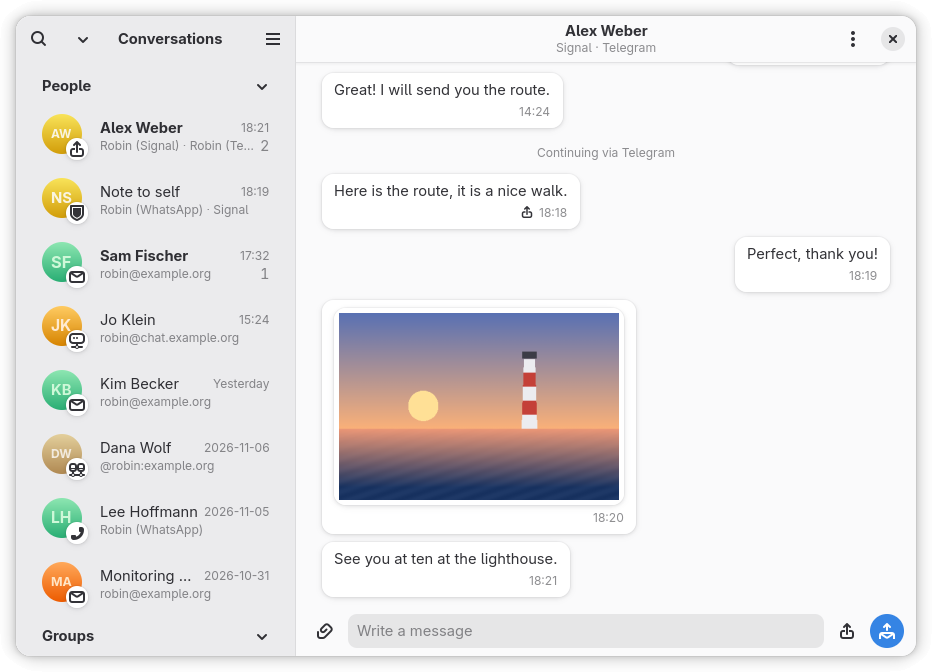
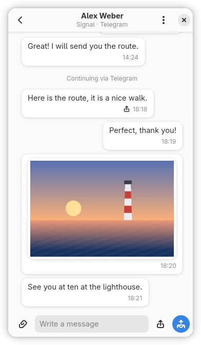
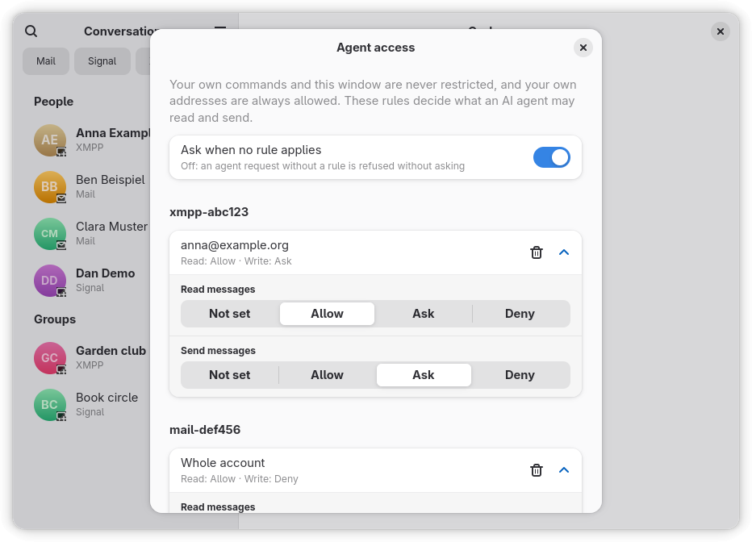

# MCP server, agent access and your data

## As an MCP server

`curlew mcp` speaks MCP over stdio. Registered in an MCP client it exposes
`mail_search`, `mail_get_message`, `mail_list_folders`, `mail_list_parts`,
`mail_save_attachment`, `mail_search_local`, `mail_sync_status`,
`conversations_list`, `conversations_get`, `message_save_attachment`, `contacts_search`,
`calendar_list_events` and `accounts_list` — plus `send_message` when some
`<backend>.send` grant exists.

The server is read-only by default and **fails closed**: a tool is registered
only if it declares itself read-only or a grant names its capability, so a
future write tool that forgets its annotation is withheld rather than silently
exposed. `send_message` is always listed, and every call is checked: your own
address needs no grant, anything else the exact `<account>/<address>` pair.

See [`.mcp.json`](../../.mcp.json) for a working registration.

## Your data stays yours

The local index contains message headers **and** plain-text bodies. It lives at
`$XDG_DATA_HOME/curlew/index.db` (mode `0600`), never inside this repository,
and only `curlew sync` and `curlew daemon` ever write to it — a search never
does. Attachments
are saved to your download directory. Both locations are overridable via
`CURLEW_DATA_DIR`, `CURLEW_DB_PATH` and `CURLEW_ATTACHMENTS_DIR`.

### Demo mode

`CURLEW_DEMO=1 curlew window` (or `curlew demo`) opens the window on made-up data: no accounts, no
network, nothing sent. The data is generated into `$XDG_CACHE_HOME/curlew-demo` (override with
`CURLEW_DEMO_DIR`) when it is missing or from an older version, and your real index, config and
accounts are not read. Every name and address is invented (`example.org`).

Your decisions — enabled backends, accepted terms, per-sender classification —
live in `$XDG_CONFIG_HOME/curlew/config.json` (mode `0600`, override with
`CURLEW_CONFIG`). Unlike the index they cannot be rebuilt from a server, so
back that file up. Keys this build does not know are kept when it saves the file.

**Agent writes are off unless granted** ([ADR 0004](../adr/0004-sending-and-writing-granted-per-capability.md),
[ADR 0008](../adr/0008-grants-restrict-agents-not-the-person.md)): grants are agent access,
checked by the CLI and the MCP server, not by your own frontends.
`grants` lists capabilities, each bound to exactly one target; no wildcards, and a
missing or empty list denies everything. A malformed entry, an empty target or an
unknown capability is an error when the file loads.

```json
{
  "grants": [
    { "capability": "xmpp.send", "target": "<account>/<address>" },
    { "capability": "mail.send", "target": "<account>/<address>" },
    { "capability": "telegram.send", "target": "<account>/<chat id>" },
    { "capability": "matrix.send", "target": "<account>/<room id>" },
    { "capability": "signal.send", "target": "<account>/<ACI>" },
    { "capability": "whatsapp.send", "target": "<account>/<chat jid>" }
  ]
}
```

`xmpp.send`, `mail.send`, `telegram.send`, `matrix.send`, `signal.send` and `whatsapp.send` are
the capabilities a command or tool uses today
(see [Sending](protocols.md#sending-grants-backendsend)); a later backend gets its own
`<backend>.send` row when it is built, and an unknown one is a config error.

**Agent access per account and contact** ([ADR 0009](../adr/0009-agent-access-per-account-and-contact.md)) —
`agentAccess` holds rules that give one account, or one
account/contact pair, a `read` mode (message bodies) and a `write` mode (sending): `allow`,
`ask` or `deny`. A contact rule beats an account rule per kind, and a kind a rule leaves out falls
through to the next rule up, then to `askWithoutRule` (default `true`: ask; `false`: deny). An
explicit `deny` is final, and a write needs the read: `write` `allow`/`ask` with `read` `deny`
is an error. Two rules with the same scope, an unknown key or a bad mode are errors when the
file loads. Your old `<backend>.send` grants are read as contact rules with `read` and `write`
`allow`, in memory; an explicit contact rule for the same pair wins, and the file is never rewritten.

**Agents are held to these rules; you are not.** The MCP tools and the agent commands of the CLI
(`curlew send`, and the read commands below) check them; your own use of the CLI and the GTK app
checks nothing. A message to your own address is always allowed.

- **Write** — `send_message` and `curlew send` need `write`. `allow` sends, `deny` refuses and
  names the config key with an example rule, `ask` asks you (below).
- **Read** — only message *bodies* are gated: `conversations_get` with `include_bodies`,
  `xmpp_wait_reply`, `mail_get_message`, `mail_save_attachment`, `message_save_attachment`, and the CLI's
  `conversations show --bodies`, `mail message`, `mail attachment` and the same for a `query` or
  `body` search. Metadata (who, when, subjects, lists) stays readable. A mail's contact is its
  sender (or, for your own mail, every recipient); a chat's contacts are its participants, so a
  rule on a Matrix room id does not match a member-based check — write the rule for the member.
- **Searches never ask.** `mail_search` with a query and `index_search` return only the hits
  whose contact you have allowed, and say how many were left out (`withheld`); read that
  conversation directly to be asked.

**The prompt.** On `ask`, the running `curlew daemon` shows a desktop notification — *Allow once*,
*For this session*, *Always*, *Deny* — naming the contact and, for a send, the first 80
characters of the text. *For this session* lasts until that MCP process ends and lives in the
daemon's memory only; a CLI call is always "once" and is not offered it. *Always* adds a rule to
`agentAccess.rules` (a migrated rule is never rewritten). A dismissed notification, a *Deny* and
no answer within 2 minutes all refuse; after a *Deny* the same session is not asked again for
that contact and kind. Without a running daemon or a notification service, `ask` refuses and
says so — start `curlew daemon`, or add a rule. Give the MCP tool call a timeout above 2 minutes
in your agent, or it gives up while you are still reading.

**Behaviour change in 0.2.0:** with no rule, bodies and sends are `ask`, so an agent that could
read mail or chats freely before is now asked about, per contact. To keep the old behaviour for
an account, add `{ "account": "<id>", "read": "allow" }`.

```json
{
  "agentAccess": {
    "askWithoutRule": true,
    "rules": [
      { "account": "xmpp-abc123", "read": "allow", "write": "ask" },
      { "account": "xmpp-abc123", "contact": "friend@example.org", "read": "allow", "write": "allow" },
      { "account": "mail-def456", "read": "deny", "write": "deny" }
    ]
  }
}
```

**The window.** `curlew window` opens a GTK 4 / libadwaita window (needs GJS and a desktop
session; only this explicit command opens it, so a bare `curlew`, and an agent running one, never
shows a window). The sidebar is one read-only list of every conversation from the local index,
whatever the messenger, in collapsible sections *People* and *Groups*. Each row shows an avatar with
a small protocol badge, the title (bold while unread), the protocol and account, and a grey unread
count. Filter chips narrow it by protocol (and by account, once a protocol with several is
chosen); the search button filters by name. One person with several messengers is one row and
one chat, whichever protocol a message came by. Pictures show in the bubble; other files open from
a tile. At 720 sp and narrower the window collapses to one pane, down to 360 px wide. The layout rules and
their role models are in [`docs/design/ui.md`](../design/ui.md).





**Agent access** is not a main area: it opens from the primary menu as a dialog. It lists the
rules grouped by account, with `Name (address)` where the index knows the contact and *Whole
account* for an account-wide rule. Each rule has a read and a write mode (allow, ask, deny); you
can remove a rule, add one, and switch `askWithoutRule`. Your own commands and the window are
never restricted, and your own addresses are always allowed — the dialog says so.



- *Writing.* Every edit re-reads `config.json`, changes only `agentAccess`, and writes it
  atomically with mode 0600 — no other key is touched. The daemon can write the same file (an
  *Always* answer); there is no file lock, so the two can still race within the milliseconds
  between read and rename. The window watches the file and reloads after any change, so what it
  shows is what is on disk, also after a refused edit.
- *Migrated rules.* A rule that exists only because of an old `mail.send` / `xmpp.send` grant is
  shown with a note. Changing a mode makes it a rule of its own. It cannot be removed on its
  own — the grant stays in your configuration — and removing the explicit rule brings the
  migrated one back.
- *Not yet.* The ask prompt is still a desktop notification; showing it in this window is open,
  and so is the app icon.

Chat sessions (Telegram, WhatsApp, Matrix — including Matrix's crypto store) and
chat passwords (XMPP) are **secrets**, kept apart from the index under
`$XDG_DATA_HOME/curlew/secrets/` — no command or MCP tool ever returns one.
The index can be rebuilt from the servers **unless WhatsApp is enabled**:
WhatsApp keeps no archive, so its messages in the index are the only copy
(`curlew backends list` shows this as `storeTier: state`).

Nothing is sent anywhere. Curlew talks to your mail server — and to Telegram,
WhatsApp, your XMPP server or your Matrix homeserver if you enabled them — and
to nothing else.

